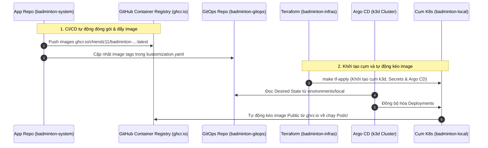

# Hướng dẫn Bật Demo Local Hệ thống Badminton Manager V2 (k3d + Argo CD GitOps)

Tài liệu này hướng dẫn chi tiết cách khởi động, kiểm tra và trình diễn (demo) hệ thống **Badminton Manager V2** theo chuẩn kiến trúc GitOps hiện đại, kết hợp 3 repositories:
- Mã nguồn ứng dụng: [`chiendz11/badminton_system`](https://github.com/chiendz11/badminton_system)
- Trạng thái Kubernetes (GitOps): [`chiendz11/badminton-gitops`](https://github.com/chiendz11/badminton-gitops)
- Hạ tầng & Vận hành (IaC): [`chiendz11/badminton-infras`](https://github.com/chiendz11/badminton-infras)

---

## 1. Luồng Vận hành Local Staging (Chuẩn GitOps End-to-End)

Cụm Kubernetes local (`k3d`) vận hành tương tự như một môi trường Staging thực thụ tại doanh nghiệp:



---

## 2. Quy trình Khởi chạy Nhanh bằng Terraform (Khuyên dùng)

### Bước 1: Khởi động Docker Service trên máy

```bash
sudo systemctl start docker
```

### Bước 2: Dựng cụm k3d và nạp GitOps bằng 1-Click Terraform

Đứng tại thư mục `badminton-infras`:

```bash
cd /home/chienqt/Dev/newBTL/badminton-infras

# Dựng cụm k3d cluster, nạp secrets và bootstrap Argo CD
make tf-apply
```
> Lệnh này sẽ tự động khởi tạo môi trường Python ảo `.venv`, tạo cụm k3d `badminton-local`, nạp toàn bộ secrets môi trường và kích hoạt Argo CD để đồng bộ manifests từ `badminton-gitops`. Toàn bộ Pods sẽ tự động kéo image từ `ghcr.io/chiendz11/...` về chạy!

### Bước 3: Chạy Database Migration & Khởi tạo Dữ liệu mẫu (Seed Data)

```bash
make local-migrate
```
Lệnh trên thực thi tuần tự:
1. `booking-core`: Áp dụng Prisma migrations và nạp dữ liệu mẫu (sân, giờ đặt, người dùng demo).
2. `ai-service`: Áp dụng Alembic migrations và script khởi tạo bảng hội thoại `app.migrate`.

### Bước 4: Kiểm tra trạng thái hệ thống

```bash
make local-status
```
Hoặc kiểm tra trực tiếp qua `kubectl`:
```bash
export KUBECONFIG="$PWD/local/.local/kubeconfig"
kubectl get deployments,pods -n badminton
```

---

## 3. Trải nghiệm Demo trên Trình duyệt

Sau khi hoàn tất, mở trình duyệt và truy cập các cổng loopback trên máy:

| Dịch vụ | URL Trải nghiệm | Mô tả chức năng |
| :--- | :--- | :--- |
| **Giao diện Người dùng đặt sân (Web Frontend)** | [**http://127.0.0.1:18082**](http://127.0.0.1:18082) | Xem danh sách sân, lịch trống và trò chuyện với Trợ lý AI đặt sân. |
| **Giao diện Quản trị viên (Admin Frontend)** | [**http://127.0.0.1:18083**](http://127.0.0.1:18083) | Quản lý bảng giá, duyệt booking và theo dõi thống kê doanh thu. |
| **API Gateway Health Check** | `http://127.0.0.1:18081/health/ready` | Cổng kiểm tra sức khỏe của API Gateway điều phối. |
| **Argo CD UI GitOps** | [**https://127.0.0.1:19445**](https://127.0.0.1:19445) | Bảng điều khiển GitOps quản lý trạng thái đồng bộ Pods và Datastores. |

---

## 4. Tùy chọn Phụ: Chế độ Phát triển Offline (Inner-Loop Dev)

Nếu bạn đang sửa code dở dang trên máy, chưa muốn commit/push lên GitHub hoặc làm việc khi không có mạng, bạn có thể build và import image trực tiếp từ source máy:

```bash
# Đóng gói image từ source local
make local-build

# Nạp trực tiếp image vào k3d cache
make local-import
```

---

## 5. Dọn dẹp Môi trường Demo

Khi muốn tắt và xóa toàn bộ cụm k3d để giải phóng tài nguyên RAM/CPU:

```bash
cd /home/chienqt/Dev/newBTL/badminton-infras
make tf-destroy
```
