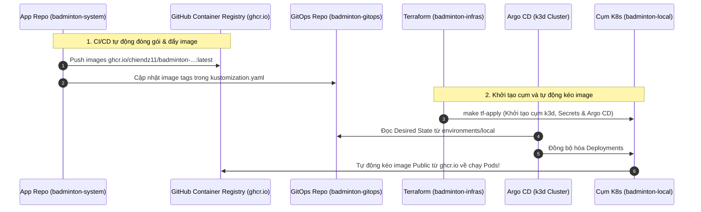

# Hướng dẫn Bật Demo Local Hệ thống Badminton Manager V2 (k3d + Argo CD GitOps)

Tài liệu này hướng dẫn chi tiết cách khởi động, kiểm tra và trình diễn (demo) hệ thống **Badminton Manager V2** theo chuẩn kiến trúc GitOps hiện đại, kết hợp 3 repositories:
- Mã nguồn ứng dụng: [`chiendz11/badminton_system`](https://github.com/chiendz11/badminton_system)
- Trạng thái Kubernetes (GitOps): [`chiendz11/badminton-gitops`](https://github.com/chiendz11/badminton-gitops)
- Hạ tầng & Vận hành (IaC): [`chiendz11/badminton-infras`](https://github.com/chiendz11/badminton-infras)

---

## 1. Luồng Vận hành Local Staging (Chuẩn GitOps End-to-End)

Cụm Kubernetes local (`k3d`) vận hành tương tự như một môi trường Staging thực thụ tại doanh nghiệp:



---

## 2. Quy trình Khởi chạy Nhanh bằng Terraform (Khuyên dùng)

### Bước 1: Khởi động Docker Service trên máy

```bash
sudo systemctl start docker
```

### Bước 2: Dựng cụm k3d và nạp GitOps bằng 1-Click Terraform

Đứng tại thư mục `badminton-infras`:

```bash
cd /home/chienqt/Dev/newBTL/badminton-infras

# Dựng cụm k3d cluster, nạp secrets và bootstrap Argo CD
make tf-apply
```
> Lệnh này sẽ tự động khởi tạo môi trường Python ảo `.venv`, tạo cụm k3d `badminton-local`, nạp toàn bộ secrets môi trường và kích hoạt Argo CD để đồng bộ manifests từ `badminton-gitops`. Toàn bộ Pods sẽ tự động kéo image từ `ghcr.io/chiendz11/...` về chạy!

### Bước 3: Chạy Database Migration & Khởi tạo Dữ liệu mẫu (Seed Data)

```bash
make local-migrate
```
Lệnh trên thực thi tuần tự:
1. `booking-core`: Áp dụng Prisma migrations và nạp dữ liệu mẫu (sân, giờ đặt, người dùng demo).
2. `ai-service`: Áp dụng Alembic migrations và script khởi tạo bảng hội thoại `app.migrate`.

### Bước 4: Kiểm tra trạng thái hệ thống

```bash
make local-status
```
Hoặc kiểm tra trực tiếp qua `kubectl`:
```bash
export KUBECONFIG="$PWD/local/.local/kubeconfig"
kubectl get deployments,pods -n badminton
```

---

## 3. Trải nghiệm Demo trên Trình duyệt

Hệ thống hỗ trợ 2 phương thức truy cập: **Ingress Domain (Khuyên dùng - Chuẩn kiến trúc ALB)** và **Loopback Ports**:

### Cách 1: Truy cập qua Tên miền Ingress (Mô phỏng AWS ALB)
Thêm bản ghi phân giải tên miền local vào file `/etc/hosts` của máy (chạy một lần):
```bash
echo "172.24.0.2 web.badminton.local admin.badminton.local api.badminton.local badminton.local" | sudo tee -a /etc/hosts
```

Sau đó mở trình duyệt và truy cập:
| Dịch vụ | Tên miền Ingress | Mô tả chức năng |
| :--- | :--- | :--- |
| **Web Portal (Đặt sân & AI Chat)** | [**http://web.badminton.local**](http://web.badminton.local) | Xem sân, lịch trống và trò chuyện trực tiếp với AI Groq (OpenAI-compatible). |
| **Admin Portal (Quản trị)** | [**http://admin.badminton.local**](http://admin.badminton.local) | Quản lý bảng giá, duyệt booking và thống kê doanh thu. |
| **API Gateway** | `http://api.badminton.local/health/ready` | Định tuyến ngược (Reverse Proxy) vào các microservices. |
| **Argo CD UI GitOps** | [**https://127.0.0.1:19445**](https://127.0.0.1:19445) | Bảng điều khiển quản lý trạng thái đồng bộ Pods và Datastores. |

*(Nếu không muốn sửa `/etc/hosts`, bạn có thể kiểm thử trực tiếp qua `curl --resolve web.badminton.local:80:172.24.0.2 http://web.badminton.local/`)*

### Cách 2: Truy cập qua Cổng Loopback NodePort Truyền thống
- **Web Frontend**: [http://127.0.0.1:18082](http://127.0.0.1:18082)
- **Admin Frontend**: [http://127.0.0.1:18083](http://127.0.0.1:18083)
- **API Gateway**: `http://127.0.0.1:18081/health/ready`

---

## 4. Kiểm tra Kiến trúc AWS Cloud Parity (Nâng cao)

Hệ thống k3d local đã được tích hợp đầy đủ 4 tính năng chuẩn Production:

### 1. Đồng bộ Secrets qua LocalStack (AWS Secrets Manager) & External Secrets Operator (ESO)
Toàn bộ secrets nhạy cảm (`LLM_API_KEY`, `JWT_SECRET`, `AI_DATABASE_URL`) được lưu trong LocalStack và ESO tự động kéo về k8s:
```bash
export KUBECONFIG="$PWD/local/.local/kubeconfig"
kubectl get externalsecrets -n badminton
```
*Trạng thái `STATUS: SecretSynced` và `READY: True` xác nhận bí mật được bảo vệ chuẩn AWS Secrets Manager.*

### 2. Trợ lý AI thực tế (Real Groq LLM Inference)
AI Service chạy với `AI_PROVIDER=openai-compatible`, `AI_OFFLINE=false` kết nối API Groq Cloud (`openai/gpt-oss-120b`). Bạn có thể kiểm tra log xử lý suy luận trực tiếp:
```bash
kubectl logs -n badminton deployment/ai-service -f
```

### 3. Tự động co giãn Pods (Horizontal Pod Autoscaler - HPA)
Các microservices được cấu hình HPA với ngưỡng 70% CPU, tự động co giãn từ 2 đến 6 replicas:
```bash
kubectl get hpa -n badminton
```

### 4. Phân vùng mạng an toàn (Zero-Trust NetworkPolicies)
Các chính sách mạng cô lập từng dịch vụ và chỉ mở các luồng dữ liệu hợp lệ:
```bash
kubectl get networkpolicies -n badminton
```

---

## 5. Tùy chọn Phụ: Chế độ Phát triển Offline (Inner-Loop Dev)

Nếu bạn đang sửa code dở dang trên máy, chưa muốn commit/push lên GitHub hoặc làm việc khi không có mạng, bạn có thể build và import image trực tiếp từ source máy:

```bash
# Đóng gói image từ source local
make local-build

# Nạp trực tiếp image vào k3d cache
make local-import
```

---

## 5. Dọn dẹp Môi trường Demo

Khi muốn tắt và xóa toàn bộ cụm k3d để giải phóng tài nguyên RAM/CPU:

```bash
cd /home/chienqt/Dev/newBTL/badminton-infras
make tf-destroy
```
