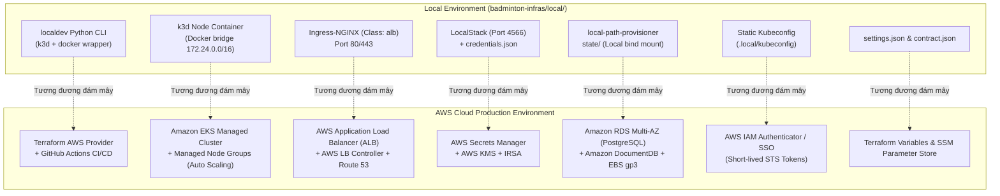

# Phân Tích Đối Chiếu: Local Parity (k3d) vs Production AWS Cloud

Tài liệu này phân tích chi tiết sự đối chiếu kiến trúc 1-1 giữa môi trường phát triển / demo cục bộ (`badminton-infras/local/`) và kiến trúc triển khai trên môi trường Production **Amazon Web Services (AWS)** của hệ thống **Badminton Manager V2**.

---

## 1. Tổng quan Kiến trúc: Local Parity vs AWS Cloud

Mục tiêu cốt lõi của thư mục `badminton-infras/local/` là tạo ra một môi trường giả lập đám mây (Cloud Simulation) có **độ trung thực cao (high parity)** trên máy trạm của lập trình viên mà không làm phát sinh chi phí hạ tầng AWS.



---

## 2. Bảng Đối Chiếu Chi Tiết 1-1 Theo Cấu Trúc Thư Mục `/local`

| Thư mục / File Local | Chức năng ở Local | Dịch vụ thay thế trên AWS Cloud | Cơ chế hoạt động trên AWS |
| :--- | :--- | :--- | :--- |
| `local/.local/credentials.json` | Chứa mật khẩu plaintext của Postgres, JWT Secret, Token | **AWS Secrets Manager** + **AWS KMS** | Mã hóa at-rest bằng KMS CMK; phân quyền truy cập qua IAM Policies & IRSA. |
| `local/.local/state/` (PVCs) | Bind-mount volume vào container k3d qua `local-path-provisioner` | **Amazon RDS Multi-AZ** + **Amazon EBS (gp3)** | Database quan hệ chuyển thành Managed RDS tự động replicate sang AZ khác; Pod dùng EBS CSI Driver. |
| `local/.local/kubeconfig` | File chứng chỉ và private key tĩnh của admin cụm k3d | **AWS IAM EKS Authentication** | Dùng `aws eks update-kubeconfig`. Xác thực bằng short-lived STS tokens (15 phút), tích hợp IAM SSO & MFA. |
| `local/.local/cluster-owner.json` | Đánh dấu người sở hữu cụm k3d trên máy dev | **AWS EKS Access Entries** & **IAM Roles** | Quản lý định danh truy cập cụm thông qua IAM Roles và Kubernetes RBAC ClusterRoles. |
| `local/.local/settings.json` & `config/settings.example.json` | Cấu hình tham số môi trường dev (tên cụm, CIDR, ports) | **Terraform Variables (`terraform.tfvars`)** & **AWS SSM Parameter Store** | Quản lý cấu hình biến hạ tầng qua IaC và biến ứng dụng qua AWS SSM / ConfigMaps. |
| `local/config/k3d.yaml` | Cấu hình cụm k3d (node count, extraArgs, port forwards) | **Amazon EKS Managed Cluster** + **Managed Node Groups** | File Terraform `terraform/platform/eks.tf` tạo EKS Control Plane và EC2 Auto Scaling Groups đa vùng. |
| `local/config/contract.json` & `versions/platform.lock.json` | Khóa phiên bản add-ons và contract k3d | **EKS Managed Add-ons** & **`.terraform.lock.hcl`** | EKS API quản lý VPC-CNI, CoreDNS, Kube-Proxy, EBS CSI; Terraform lockfile khóa chính xác provider hashes. |
| `local/versions/k3d-v1alpha5.schema.json` | JSON Schema xác thực file cấu hình k3d | **AWS CloudFormation / Terraform Provider Schema** | Được kiểm tra tự động bởi Terraform validation và AWS API JSON Schemas khi plan/apply. |
| `localdev` (Python CLI scripts) | Tự động hóa docker, k3d, nạp secret và cài Argo CD | **Terraform AWS Provider** + **Argo CD** + **GitHub Actions** | Tự động hóa provisioning toàn bộ hạ tầng AWS và triển khai ứng dụng tự động qua GitOps pipeline. |

---

## 3. Phân Tích Kỹ Thuật Chuyên Sâu Từng Thành Phần

### 3.1. Quản lý Bí mật: `credentials.json` $\rightarrow$ AWS Secrets Manager + IRSA
- **Ở Local**:
  - Script `localdev/credentials.py` đọc mật khẩu từ file plaintext JSON `local/.local/credentials.json`.
  - Môi trường nâng cấp (Local Parity) đã chuyển sang dùng **LocalStack** giả lập AWS Secrets Manager API và **External Secrets Operator (ESO)** để đồng bộ trực tiếp vào Kubernetes Secret `ai-service-secrets`.
- **Trên AWS Cloud**:
  - Không bao giờ tồn tại file `credentials.json`.
  - Các bí mật nghiệp vụ (`badminton/prod/ai-service-runtime`, `badminton/prod/llm`, `badminton/prod/payos`) được lưu trực tiếp trong **AWS Secrets Manager**.
  - **Cơ chế IRSA (IAM Roles for Service Accounts)**:
    - EKS kích hoạt OIDC Identity Provider (`oidc.eks.<region>.amazonaws.com/id/...`).
    - ServiceAccount `external-secrets` trong namespace `external-secrets` được gắn IAM Role `badminton-prod-eso-role` thông qua annotation `eks.amazonaws.com/role-arn`.
    - Pod ESO gửi Kubernetes ServiceAccount token lên AWS STS để đổi lấy temporary credentials có quyền `secretsmanager:GetSecretValue` trên đúng ARN của project.
    - Workload Pods hoàn toàn không cần cấp quyền AWS IAM; ứng dụng chỉ đọc secrets qua native Kubernetes Secret (`envFrom.secretRef`).

### 3.2. Lưu trữ Dữ liệu Bền vững: `local/.local/state/` $\rightarrow$ Amazon RDS & Amazon EBS gp3
- **Ở Local**:
  - Container PostgreSQL và MongoDB chạy dưới dạng Pod/StatefulSet trong Kubernetes.
  - Dữ liệu được ghi vào thư mục máy chủ tại `local/.local/state/pvc-...` thông qua StorageClass `local-path`. Nếu xóa folder này, database mất toàn bộ dữ liệu.
- **Trên AWS Cloud**:
  - **Dịch vụ Cơ sở dữ liệu Quản lý (Managed DB)**:
    - PostgreSQL không còn chạy trong Kubernetes mà chuyển sang **Amazon RDS Multi-AZ** (Engine: PostgreSQL 16).
    - Database được đặt trong Private DB Subnet (không có Internet Gateway), chỉ mở cổng 5432 tới Security Group của EKS Worker Nodes.
    - Tự động sao lưu Point-In-Time Restore (PITR) trong 35 ngày, snapshot sang S3, và tự động failover sang standby replica ở Availability Zone khác trong vòng 60 giây khi có sự cố.
  - **Amazon EBS gp3 Volume**:
    - Đối với các dịch vụ stateful nội bộ cụm (như Prometheus Alertmanager hoặc Argo CD Redis), AWS EBS CSI Driver tự động tạo ổ đĩa EBS gp3 trên AWS theo yêu cầu của PersistentVolumeClaim (PVC).

### 3.3. Xác thực & Phân quyền: `local/.local/kubeconfig` $\rightarrow$ AWS IAM Authenticator
- **Ở Local**:
  - File `kubeconfig` chứa `client-certificate-data` và `client-key-data` với quyền `system:masters` (quyền tối cao). Bất kỳ ai có file này đều có toàn quyền kiểm soát cụm.
- **Trên AWS Cloud**:
  - File `kubeconfig` của AWS EKS **không chứa chứng chỉ tĩnh hay private key**.
  - Kubeconfig chỉ cấu hình lệnh `exec`:
    ```yaml
    users:
    - name: arn:aws:eks:ap-southeast-1:123456789012:cluster/badminton-prod
      user:
        exec:
          apiVersion: client.authentication.k8s.io/v1beta1
          command: aws
          args:
          - eks
          - get-token
          - --cluster-name
          - badminton-prod
    ```
  - Mỗi khi thực hiện `kubectl`, AWS CLI gọi API `sts:GetCallerIdentity` để ký một URL token có hạn sử dụng 15 phút.
  - EKS Control Plane giải mã token qua **EKS Access Entries**, map danh tính AWS IAM (User/Role) sang Kubernetes RBAC Role/Group tương ứng (ví dụ: `view`, `edit`, `admin`).

### 3.4. Định tuyến & Mạng: Port Forwards $\rightarrow$ AWS ALB + Route 53
- **Ở Local**:
  - k3d forward cố định các cổng NodePort ra máy chủ: `18081` (API Gateway), `18082` (Web), `18083` (Admin).
  - Ở bản nâng cấp Local Parity, **Ingress-NGINX** (đóng vai trò ALB) lắng nghe cổng 80/443 của node ảo để định tuyến domain ảo `*.badminton.local`.
- **Trên AWS Cloud**:
  - **AWS Load Balancer Controller**: Lắng nghe Ingress resource có `ingressClassName: alb`.
  - Tự động provision một **Application Load Balancer (ALB)** trên 3 Public Subnets.
  - Tự động gắn chứng chỉ TLS từ **AWS Certificate Manager (ACM)** để mã hóa HTTPS cổng 443.
  - **ExternalDNS**: Tự động phát hiện Ingress rules và tạo bản ghi DNS `A (Alias)` trên **Amazon Route 53** trỏ tới DNS name của ALB.

---

## 4. Kết luận

Mô hình phát triển **Local Parity** của dự án Badminton Manager V2 đã đạt được sự tương đồng thiết kế kiến trúc cao nhất với Production AWS:
1. Mọi manifest K8s (Deployment, Service, HPA, NetworkPolicy, Ingress, ExternalSecret) đều dùng chung spec với Production.
2. Quá trình chuyển từ chạy thử trên máy local sang chạy trên hạ tầng AWS thực tế chỉ cần thay đổi **ClusterSecretStore provider endpoint** và **StorageClass/IngressClass**, hoàn toàn không cần sửa đổi bất kỳ dòng mã nguồn ứng dụng nào.
